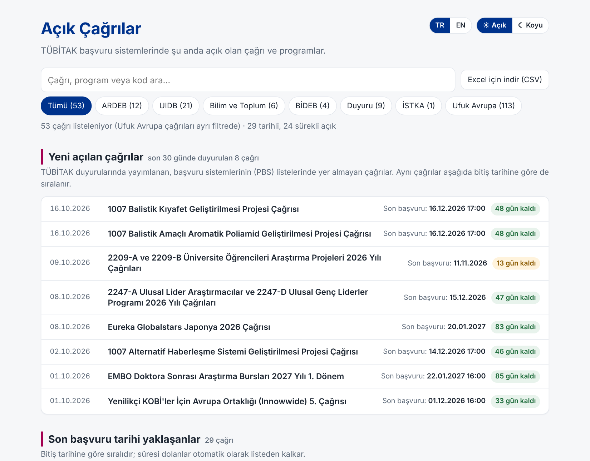
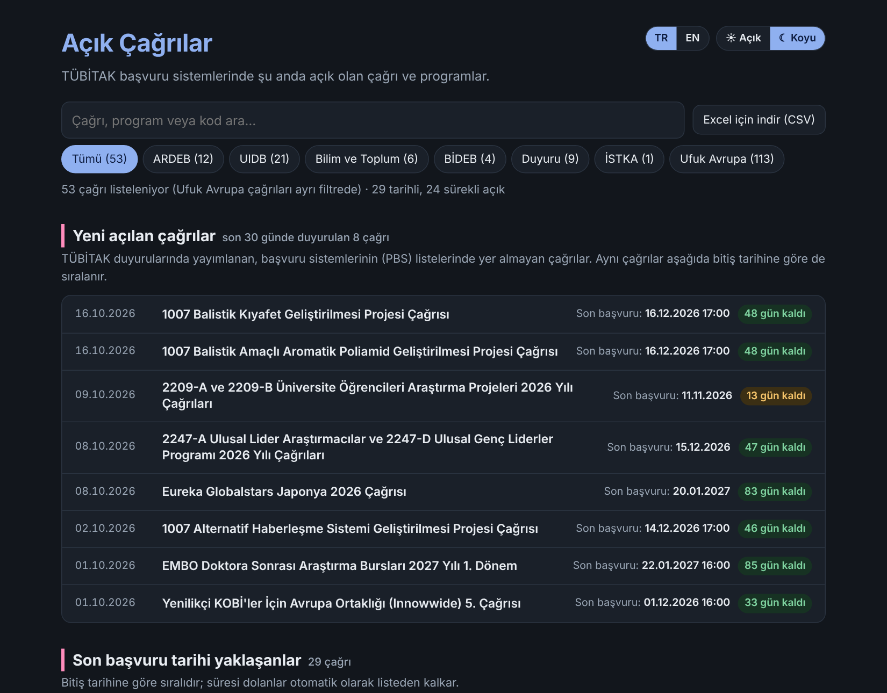
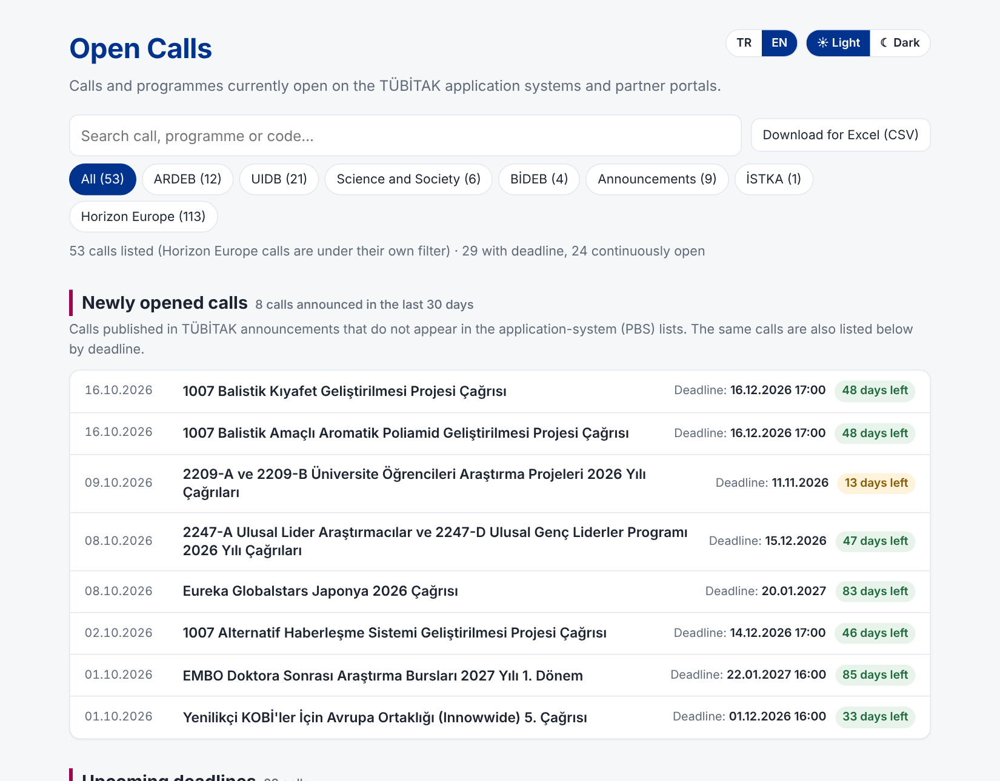
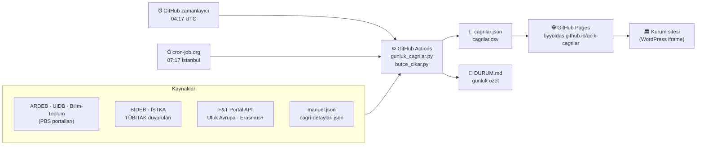

<div align="center">

# 📣 Açık Çağrılar

**TÜBİTAK, BİDEB, İSTKA, Ufuk Avrupa ve Erasmus+ çağrılarını her gün otomatik toplayan, tek sayfada gösteren sistem.**

[](https://github.com/Byyoldas/acik-cagrilar/actions/workflows/gunluk.yml)


### 🔗 [Canlı sayfa](https://byyoldas.github.io/acik-cagrilar/) · [Günlük durum](DURUM.md) · [Manuel giriş formu](https://byyoldas.github.io/acik-cagrilar/giris-formu.html)



</div>

---

## ✨ Neler sunar?

- 🔎 **Tek yerde arama ve filtre:** kaynak, çağrı adı, program veya koda göre.
- ⏳ **Son tarihe göre sıralama:** "N gün kaldı" rozetleri, süresi dolanlar kendiliğinden listeden kalkar.
- 🆕 **Yeni açılan çağrılar:** TÜBİTAK duyurularında yayımlanıp başvuru sistemlerinde henüz görünmeyen çağrılar.
- 💶 **Bütçe ve süre bilgisi:** çağrı sayfaları ve PDF'lerden otomatik çıkarılır; elle girilen bilgi önceliklidir.
- 🌗 **Açık / koyu tema** ve 🇹🇷 / 🇬🇧 **TR / EN** dil geçişi.
- 📥 **Excel için CSV indirme.**
- 🧩 **WordPress'e gömülebilir** (iframe).

<table>
<tr>
<td align="center"><b>Koyu tema</b><br></td>
<td align="center"><b>İngilizce arayüz</b><br></td>
</tr>
</table>

## 🧭 Nasıl çalışır?



1. **Tetikleme:** Her sabah GitHub'ın kendi zamanlayıcısı ve yedek olarak cron-job.org iş akışını başlatır. `manuel.json`, `cagri-detaylari.json` ya da sayfa değiştiğinde de kendiliğinden çalışır.
2. **Toplama:** Betik kaynakları okur, süresi dolanları eler, bir kaynak alınamazsa son başarılı sonucu kullanır.
3. **Zenginleştirme:** Bütçe/süre bilgisi çağrı sayfalarından ve PDF'lerden çıkarılır (UIDB için yalnızca "proje başına" ve "yürütücü kuruluş başına" limitler).
4. **Yayın:** Sonuç GitHub Pages'e yüklenir; `DURUM.md` günlük özetle güncellenir.

## 📚 Kaynaklar

| Kaynak | Ne alınır | Yöntem |
|---|---|---|
| ARDEB · UIDB · Bilim ve Toplum | Açık çağrılar, tarihler, bilgi notu | PBS sayfaları |
| BİDEB | Açık burs/destek programları | Statik tablo |
| TÜBİTAK duyuruları | PBS'de olmayan yeni çağrılar | Duyuru listesi + tarih çıkarma |
| İSTKA | Açık mali destek programları | Sayfa ayrıştırma |
| Ufuk Avrupa | Doğrudan ve kademeli (cascade) çağrılar | F&T Portal Search API |
| Erasmus+ | Merkezi (EACEA) çağrılar | F&T Portal Search API |
| Elle girilenler | TÜSEB, ÖzÜ iç fonları vb. | `manuel.json`, form |

> **Kapsam dışı:** TÜSEB siteleri, Eureka (bot koruması) ve ua.gov.tr (robots.txt) otomatik okunmaya izin vermiyor; bu çağrılar yalnızca elle eklenir. Erasmus+ Ulusal Ajans çağrıları, yıllık Programme Guide yayımlandığında toplu olarak elle girilir.

## ✍️ Elle çağrı ekleme

1. [Giriş formunu](https://byyoldas.github.io/acik-cagrilar/giris-formu.html) açın, mevcut `manuel.json` dosyasını seçin, çağrıyı ekleyip yeni dosyayı indirin.
2. Depoda `manuel.json` dosyasının üzerine yükleyin (commit).
3. Akış kendiliğinden çalışır ve sayfa güncellenir.

Bütçe, süre, kimler başvurabilir gibi ayrıntılar için `cagri-detaylari.json` dosyasına çağrı adının bir parçasını (`"m"`) ve bilgileri yazın. Bu dosyadaki bilgi otomatik çıkarılanın önüne geçer.

## 🧩 WordPress'e gömme

```html
<iframe id="acik-cagrilar" src="https://byyoldas.github.io/acik-cagrilar/"
        style="width:100%;border:0;min-height:600px" loading="lazy" title="Açık Çağrılar"></iframe>
<script>
window.addEventListener("message", function (e) {
  if (e.origin !== "https://byyoldas.github.io") return;
  if (e.data && e.data.type === "acik-cagrilar-height")
    document.getElementById("acik-cagrilar").style.height = e.data.height + "px";
});
</script>
```

İngilizce açmak için adrese `?lang=en` ekleyin.

## 🗂️ Dosyalar

| Dosya | Görevi |
|---|---|
| `site/index.html` | Yayınlanan sayfa (tek dosya) |
| `site/giris-formu.html` | Manuel çağrı giriş formu |
| `gunluk_cagrilar.py` | Ana betik: toplar, birleştirir, çıktı üretir |
| `fetch_eu_calls.py` | F&T Portal API (Ufuk Avrupa, Erasmus+) |
| `butce_cikar.py` | Çağrı sayfa ve PDF'lerinden bütçe/süre çıkarma |
| `manuel.json` · `cagri-detaylari.json` | Elle girilen çağrılar ve ayrıntılar |
| `DURUM.md` | Günlük durum özeti (otomatik) |
| `uyarilar.json` · `son-iyi.json` · `durum.json` · `butce-onbellek.json` | Bot tarafından tutulan durum/önbellek dosyaları |
| `.github/workflows/gunluk.yml` | Günlük akış tanımı |

## 🛠️ Bakım notları

- **Hata kontrolü:** `uyarilar.json` ve [`DURUM.md`](DURUM.md) son çalışmadaki uyarıları ve kaynak başına çağrı sayılarını gösterir.
- **Yedek tetikleyici:** cron-job.org işi, GitHub'a `workflow_dispatch` isteği gönderir. Kullanılan GitHub token'ı yalnızca bu depoya "Actions: Read and write" izni verir; yenilenirse cron-job.org'daki `Authorization` başlığı da güncellenmelidir.
- **Maliyet:** Betik yapay zekâ çağrısı yapmaz. Herkese açık depoda GitHub Actions ve Pages ücretsizdir.
- **E-posta bildirimi:** Şu an pasif. `SMTP_HOST`, `SMTP_USER`, `SMTP_PASS`, `MAIL_FROM`, `MAIL_TO` secret'ları eklenince yeni ve tarihi değişen çağrılar için gönderim başlar. Ayrıntı: [OKU.md](OKU.md).

## ⚠️ Sorumluluk notu

Bütçe ve süre bilgilerinin bir kısmı otomatik çıkarılır ve hatalı olabilir; bu bilgiler sayfada "Otomatik çıkarıldı" etiketiyle gösterilir. Başvuru öncesinde her zaman çağrının resmi sayfasını kontrol edin.
